# astrostack

Stacking short, untracked exposures from raw camera files. **[Full report](#astronomy-photo-stacking)** included below.

| Step | What happens |
| --- | --- |
| **Raw decoding** | Direct decoding of Bayer mosaic sub-lattices; prevents demosaicing, gamma correction, and white balance correlating noise and destroying linearity. |
| **Noise estimation** | Robust σ from the median absolute deviation (MAD), per frame. |
| **Background removal** | A mesh of σ-clipped medians on 64 px tiles, interpolated back to full resolution with a cubic B-spline. |
| **Detection** | 5σ threshold, binary opening to kill isolated hot pixels, dilation to recover the point spread function fringes, then flux-weighted first and second moments for sub-pixel centroids, FWHM and ellipticity. |
| **Registration** | Triangle-invariant asterism matching with mutual-best voting, then a closed-form similarity fit (Umeyama 1991) wrapped in RANSAC. Residual ≈ 0.29 px. |
| **Resampling** | Backward map with order-3 B-spline interpolation. NaNs filled, warped, then re-masked so a defect cannot smear across its spline support. |
| **Combination** | Per-pixel σ-clipped median, then an inverse-variance weighted average across frames. |
| **Analysis** | Analysis of results, comparison to ideal noise reduction levels. |

### Quickstart options

| Flag | Default | Effect |
| --- | --- | --- |
| `--channels R G B` | `R G B` | planes to stack; `G` is the mean of G1 and G2 |
| `--mono` | off | shorthand for `--channels G` |
| `--threshold` | `5.0` | detection threshold in σ. Below 4 the false-positive rate starts to matter |
| `--box` | `21` | star measurement window, about 2.6 × FWHM |
| `--box-size` | `64` | background mesh tile size |
| `--order` | `3` | resampling spline order. 1 correlates the noise, 5 costs time for nothing |
| `--combine` | `sigma_clip` | per-pixel combination |
| `--kappa` | `3.0` | per-pixel combination rejection threshold
| `--cold-cut` | `-50.0` | ADU below which a sample is discarded as an RTS pixel |
| `--bayer-dng` | off | also write a full-resolution CFA DNG |
| `--dng` | off | also write a linear DNG (LinearRaw, already demosaiced) |
| `--plots` | off | write the full set of diagnostic figures |
| `--no-fits` | FITS on | skip the FITS output |

`python stack_session.py --help` has the rest.

## As a library

```python
from astrostack import io, background, detect, register, quality, stack

cube = io.load_cube(files)
residual, level, sigma = background.residuals(cube)
detections = detect.detect_cube(residual, level, sigma)

frames, table = quality.usable_frames(detections)
reference = quality.reference_frame(table)

transforms, report = register.register_all(detections, frames, reference)
aligned, labels = stack.warp_all(cube, transforms, reference)
combined, depth = stack.stack_frames(aligned)

noise = stack.half_split_noise(aligned)
```

`tutorial.ipynb` walks the same path one stage at a time, with a diagnostic
plot and an explanation at each step.

## Repository layout

```
astrostack/           code repository
  io.py               raw -> linear Bayer planes, black subtracted
  background.py       robust sigma, mesh background, bad-pixel maps
  detect.py           thresholding, morphology, moments
  register.py         triangle invariants, Umeyama fit, RANSAC
  quality.py          per-frame quality table, frame selection
  stack.py            warping, combination, half-split noise
  output.py           FITS writer (hand-rolled), TIFF, PNG preview
  exif.py             EXIF straight out of the TIFF container
  dng.py              linear and CFA DNG writers
  plotting.py         a diagnostic figure for every stage
figures/              figures for the README
stack_session.py      the command-line pipeline
```

<br>

# Astronomy Photo Stacking

.png)

## Introduction

Astrophotography is a low signal-to-noise problem. The obvious fix is a longer
exposure, which collects more signal, but on a fixed mount the sky moves: it
drifts at **1.92 px/s** and rotates at **4.8″/s**. Anything longer than a second
or two and the stars streak.

So the exposures have to stay short, and the signal has to be recovered another
way: combine $N$ aligned short exposures, and the noise falls as $\sqrt{N}$
while the signal does not.

$$\text{many short exposures} \;+\; \text{alignment} \;\longrightarrow\; \sqrt{N}\ \text{noise reduction}$$

### Experimental equipment

| | | | |
| --- | --- | --- | --- |
| **Camera** | Canon EOS 70D | **Sensor** | APS-C, 4.11 μm pitch |
| **Lens (wide)** | 18–250 mm *f*/3.5–6.3 | **Plate scale**\* | 6.8″ per superpixel |
| **Lens (zoom)** | 75–300 mm *f*/4–5.6 | **Mount** | fixed tripod |
| **Exposure** | 0.5 s / 1 s / 2 s, ISO 4000 | **Drift** | 1.92 px s⁻¹ |
| **Frames** | 10–60 per sequence | **Field rotation** | 4.8″ s⁻¹ |

\* The plate scale connects angular size on the sky with distance in the focal
plane. It is not assumed here but *measured*, from the fitted drift against the
sidereal rate:

$$\text{scale} = \frac{\text{sky rotation}}{\text{fitted translation}}
= \frac{15.041\cos\delta}{1.922} = 7.83\cos\delta \ \ \text{arcsec px}^{-1}$$

The raw camera signal is in **ADU** (analog-to-digital units), with a black
buffer at 2048 ADU and a maximum of $2^{14} = 16384$ ADU.

## Processing pipeline

1. raw decoding
2. noise estimation
3. background removal
4. detection
5. registration
6. transform
7. reconstruction
8. analysis

## 1 · Raw decoding

The sensor is photosites under colour filters, in a Bayer pattern—one
superpixel is

$$\begin{pmatrix} R & G_1 \\ G_2 & B \end{pmatrix}$$

which `rawpy` exposes as `raw_pattern`. The standard camera post-process is
exactly what must *not* happen here. It:

- **demosaics**, interpolating between neighbours → correlates the noise;
- **gamma-corrects** → breaks linearity → no flux data;
- **white-balances** → changes colour → no velocity data.

So the mosaic is split into its four sub-lattices rather than interpolated.
Splitting is lossless: four planes of $(H/2, W/2)$ hold exactly the $H \times W$
original samples, and every sample is still an independent measurement.

Detection runs on the green channels, which are the most sensitive. Averaging
the two green sub-lattices is not free—they sample half a pixel apart, so the
average broadens the point spread function by about **4%** and shifts the
centroids—but it buys $\sqrt2$ in noise.

## 2 · Noise estimation

### Median absolute deviation

The estimator has to cover the Gaussian core and ignore the tails: it is
measuring the *background*, and the bright things in the frame—stars—are
the signal, not spread.

For $X \sim \mathcal{N}(\mu, \sigma^2)$, write $Z = (X - \mu)/\sigma$, so
$|X - \mu| = \sigma|Z|$. Since

$$\mathbb{P}(|Z| \le m) = 2\Phi(m) - 1 = 0.5 \quad\Longrightarrow\quad \Phi(m) = 0.75,$$

it follows that

$$\text{med}(|X - \mu|) = \sigma \text{med}(|Z|) = \sigma\,\Phi^{-1}(0.75),
\\
\hat\sigma = 1.482602 \text{med}\!\big(|x_i - \text{med}(x)|\big).$$

The cost is efficiency: on Gaussian data the MAD has **37% more
variance** than the standard deviation, so it needs $1.4\times$ the samples for
equal precision. With $5 \times 10^6$ pixels per image, this is not a problem.
The benefit is a breakdown point of 50% instead of 0%.

### Two populations

The estimator predicts noise of **30.1 ADU** and a sky level of **52 ADU**. If
the data were Gaussian, every quantile would imply the same σ. They do not:

| Quantile | Value (ADU) | Fraction | Implied σ |
| --- | --- | --- | --- |
| $n_\text{cold}$ ($< -50$) | −50 | $3.1 \times 10^{-3}$ | 37.3 |
| 0.01 percentile | −217 | $1.0 \times 10^{-4}$ | 72.3 |
| minimum | −450 | $2.0 \times 10^{-7}$ | 99.0 |

The implied σ climbs steadily into the tail, which is the signature of a second
population: **random telegraph signal (RTS)** pixels, with faulty transistors
that switch state between readouts. They contribute stochastic noise at *fixed
locations* on the sensor.

Therefore, a master dark cannot remove them—their value is not repeatable, only their position is—but they stay fixed
while the sky drifts across the sensor, so after registration they land on
different parts of the sky in every frame and the combination rejects them.

## 3 · Background estimation

### Signal isolation

Light pollution and airglow make the background non-uniform, so it cannot be a
single number per frame.

**Estimator:** a mesh of σ-clipped medians, interpolated back to full resolution
with a cubic B-spline. Within each $b \times b$ tile, iterate

$$m^{(k+1)} = \text{med}\big\{\,x_i \; \|x_i - m^{(k)}\| < \kappa\hat\sigma \,\big\}.$$

The median is recomputed from the survivors, but $\hat\sigma$ comes from the
**full** population each time. This is deliberate: $\hat\sigma$ assumes a
Gaussian population, and the survivors of a small $\kappa$ are a truncated core,
not a Gaussian. Clipping the scale as well as the median drives the estimate
down toward a biased fixed point instead of converging on the true spread.


- **Tile size $b = 64$**—much larger than a star (FWHM 8–10 px), much smaller
  than the gradient scale.
- **A $3\times3$ median across tiles**—a rank filter on the mesh itself, so a
  bright spot cannot drag one tile's median away from its neighbours.
- **Tile value placed at its centroid** $ib + (b-1)/2$, not at index $i$. Placing
  it at the index misplaces the background by a full tile at the far edge of the
  frame; fixing it halved the residual, **0.53 → 0.26 ADU**.

### Residual

On a fixed tripod the background is identical across frames to within
$0.4 \pm 2$ ADU. Uniform sky drift between frames is absorbed into the residual
median $m_0$ and the detection threshold is referenced to it:

$$\text{mask} = \{\, r > m_0 + k\sigma \,\}, \qquad r = \text{data} - \text{background}.$$

Referencing to $m_0$ rather than to zero means a frame taken as the sky
brightened gets the same *effective* cut as one taken earlier, instead of a
flood of spurious detections.

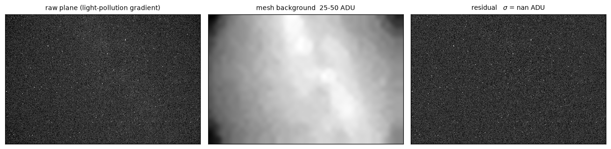

## 4 · Detection

### Thresholding

Over $N = 5{,}042{,}580 = 2748 \times 1835$ superpixels, the expected number of
pure-noise pixels above a $k\sigma$ threshold is $N\Phi(-k)$:

| $k$ | $\Phi(-k)$ | pixels/frame |
| --- | --- | --- |
| 3 | $1.35 \times 10^{-3}$ | 6807 |
| 4 | $3.17 \times 10^{-5}$ | 160 |
| 5 | $2.87 \times 10^{-7}$ | 1.4 |
| 6 | $9.87 \times 10^{-10}$ | 0.005 |

A detection requires **four connected pixels** above threshold, so at $k = 5$ the
joint probability is $\mathcal{O}(10^{-19})$ per frame. At $k \le 4$ false
detections start to appear.

### Morphology

- **Opening**—a $2\times2$ erosion followed by a dilation with the same
  element. Requires a full $2\times2$ block above threshold, which removes
  isolated hot and RTS pixels.
- **Dilation**—a $3\times3$ element grows each survivor by one pixel. This
  fixes two things:
  - **integrated flux**—clipping at $\ge 5\sigma$ cuts off the outer part of
    every star;
  - **scatter**—the star-to-star spread in what *fraction* of each star's flux
    the mask captured. Without dilation a bright star keeps more of its wings
    than a faint one, so the measurement is biased toward the bright end.

  Captured flux and scatter improve from **84.3% → 99.1%** and **25% → 6%**.

Dilation also merges stars separated by 2–3 FWHM. That is harmless for
registration, which only needs consistent positions, but it means dilation has
to be switched off for photometry.

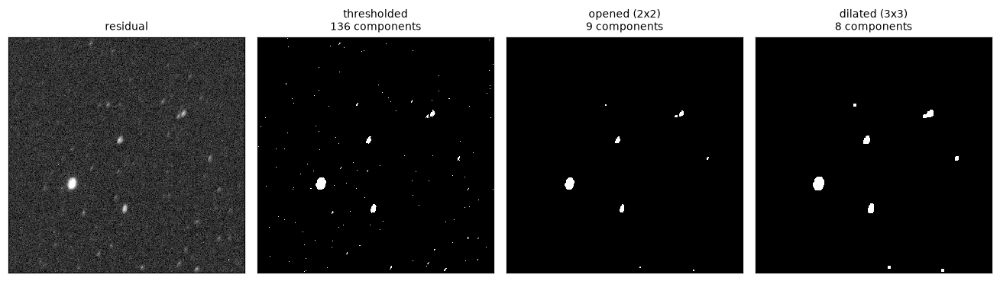

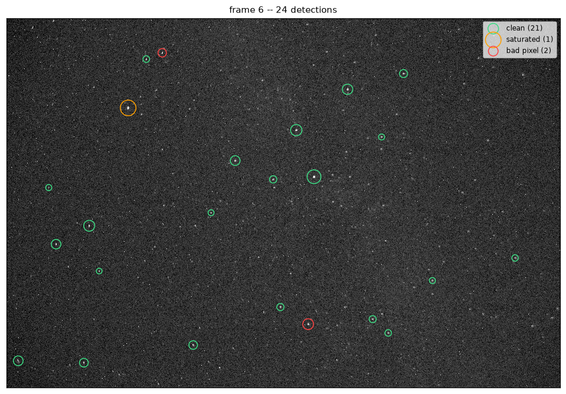

### Sub-pixel centroids

The centroid is a flux-weighted first moment over a $b \times b$ window:

$$\bar y = \frac{\sum_i w_i y_i}{\sum_i w_i}, \qquad w_i = \max(r_i - m_0,\, 0)$$

where $r_i$ is the background-subtracted residual at pixel $i$ and $m_0$ that
frame's residual median—the same reference level the threshold used.

This recovers genuinely sub-pixel information. For a symmetric point spread
function $f$ centred at true position $t$, in the continuous limit

$$\frac{\int \mathrm{d}x\; x f(x - t)}{\int \mathrm{d}x\; f(x - t)}
= \frac{\int \mathrm{d}u\; (u + t) f(u)}{\int \mathrm{d}u\; f(u)} = t
\qquad \text{since } \int \mathrm{d}u\; u f(u) = 0 \text{ by symmetry.}$$


- A weighted mean assumes non-negative weights, so downward noise is clipped.
  This keeps the denominator away from zero and cuts the centroid error
  **0.267 px → 0.042 px**.
- The window is $2.5\times$ FWHM. Too small truncates the PSF and degrades the
  centroid; too large swallows neighbours. Sweeping confirms $b = 21$ for a
  FWHM of 8 px.

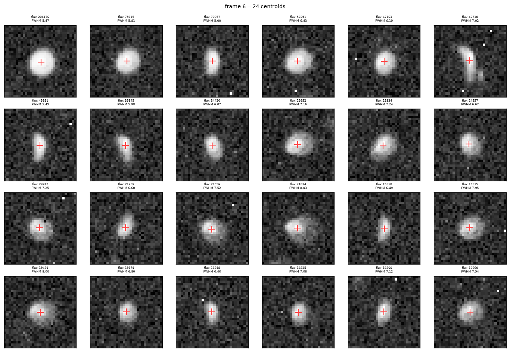

### Ellipticity and FWHM

The second central moments form a tensor

$$\begin{pmatrix} v_{yy} & v_{xy} \\ v_{xy} & v_{xx} \end{pmatrix},
\qquad
v_{yy} = \frac{\sum_i w_i (y_i - \bar y)^2}{\sum_i w_i}$$

whose eigenvalues give the shape:

$$\lambda_\pm = \tfrac12 (v_{yy} + v_{xx}) \pm \tfrac12\sqrt{(v_{yy} - v_{xx})^2 + 4v_{xy}^2},
\qquad
e = 1 - \sqrt{\lambda_-/\lambda_+}.$$

The cross-term $v_{xy}$ matters: without it a star trailed along a diagonal
measures as round, because the trailing splits evenly between $v_{yy}$ and
$v_{xx}$. Taking $\lambda_-/\lambda_+$ rather than the reverse makes $e = 0$ for a
circular source and $e \to 1$ for a line, and it is a ratio of eigenvalues, so it
is invariant under rotation of the frame.

The same moments give the full width at half maximum:

$$\text{FWHM} = 2\sqrt{2\ln 2}\;\sqrt{\tfrac12 (v_{yy} + v_{xx})} \approx 2.3548\,\sigma.$$

FWHM here is a *relative* quality measure, not an absolute seeing figure: the
window truncates the wings, the dilation changes what is inside it, and the
constant $2.3548$ assumes a Gaussian profile the real PSF only approximates.
It is tracked because frame-to-frame *changes* in it are real—wind, focus
drift, a passing thin cloud—and that is all frame selection needs.

### Discarding frames

Discarding $\xi$ bad frames out of $N$ costs

$$\sqrt{\frac{N}{N - \xi}}$$

in noise reduction—not $\sqrt{N}$, and not $\sqrt{\xi}$: the loss is the ratio
of what the full stack would have achieved to what the reduced stack does.

Measurement reversed the initial design here. Keeping frames is almost always
better:

- frames up to $2\times$ the mean FWHM are worth keeping—their centroids are
  just as good, so they register just as well;
- only high-ellipticity frames (wind, shake, over-long exposure) and frames with
  very few stars are worth discarding, and even then the threshold has to be
  loose, because removing them introduces more noise than they contribute.

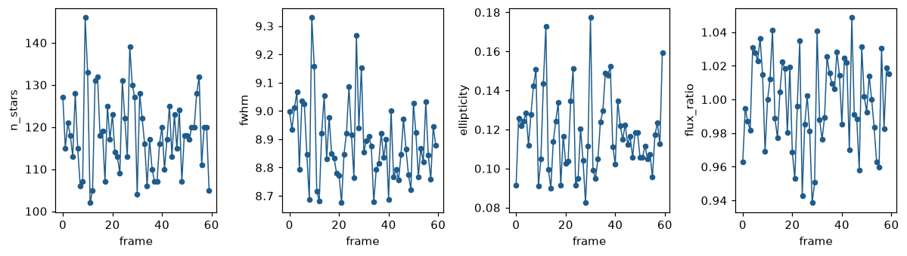

## 5 · Registration

### Invariants

The transform is what is being solved for, so the matching cannot use it. It has
to run on quantities computed from positions alone that the transform leaves
unchanged.

Triangle side ratios are such quantities. A triangle has three sides; dividing
out scale leaves two numbers, which is exactly its shape up to similarity:

$$\left(\frac{d_3}{d_2},\ \frac{d_2}{d_1}\right), \qquad d_1 < d_2 < d_3.$$

Two refinements make this much stronger:

- **Vertices are labelled by their opposite side.** Sorting by opposite side
  length is itself an invariant ordering, so two matched triangles come out with
  their vertices already in correspondence—one triangle match yields three
  *point* correspondences for free, rather than only a shape match.
- **Degenerate triples are rejected.** A near-collinear triangle has
  $d_1 \to 0$, so $d_2/d_1$ explodes and the descriptor becomes numerically
  meaningless.

A correspondence between stars $(i, j)$ is supported by every triangle that
contains both and whose other two vertices are also shared.

### Voting

With 100 stars, each star sits in $\binom{99}{2} = 4851$ triangles—$i$ is
fixed as the star in question, and the pair is drawn from the other 99.

Raw vote counts are not enough: false positives reach up to **75%** of the vote
count of the true median. The fix is **mutual best**—a correspondence is
accepted only if $i$'s best match is $j$ *and* $j$'s best match is $i$.

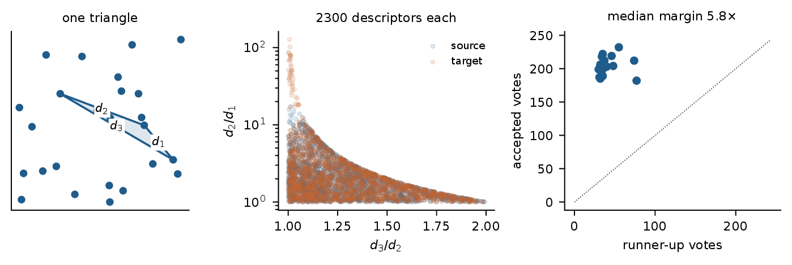

### Transform fit

The physics constrains the model. A rigid sky viewed through a fixed lens over a
few minutes gives four degrees of freedom—angle, scale, and two shifts:

$$p_\text{target} = s R\, p_\text{source} + t, \qquad R^\top R = I, \qquad \det R = 1.$$

This has a **closed-form** solution (Umeyama, 1991):

1. Centre both sets, which decouples the translation.
2. Minimising $\sum_i \|sR x_i - y_i\|^2$ over $R$ reduces to maximising
   $\text{tr}(R^\top H)$ with $H = \frac1n \sum_i y_i x_i^\top$.
3. That is the **orthogonal Procrustes** problem, solved by the singular value
   decomposition $H = U \Sigma V^\top$.
4. The SVD alone can return a *reflection*, which must be excluded:

$$R = U S V^\top, \quad S = \text{diag}(1, \det(UV^\top)), \quad
s = \frac{\text{tr}(\Sigma S)}{\frac1n \sum_i \|x_i\|^2}, \quad
t = \bar y - sR\bar x.$$

### Random sample consensus

Least squares has an unbounded influence function: **one** incorrect
correspondence introduces more than 500 px of error. The fit has to be made
robust, which means finding the largest subset of correspondences that agree.

RANSAC does this by sampling rather than by down-weighting:

1. Draw the minimal sample—here $m = 2$ correspondences, since a similarity
   has four degrees of freedom and each correspondence supplies two.
2. Fit the transform to just those two.
3. Count how many of *all* correspondences that transform predicts to within
   2 px. Those are the **inliers**; the rest are **outliers**.
4. Keep the hypothesis with the most inliers and repeat.

The number of attempts needed follows directly. If each correspondence is
correct with probability $w$, a clean sample of $m$ has probability $w^m$, so
failing $k$ times running has probability $(1 - w^m)^k$. For confidence $1 - p$:

$$k \ge \frac{\log p}{\log(1 - w^m)}.$$

At $k = 300$ this covers $w \ge 0.15$; the actual inlier fraction is $w \ge 0.9$,
so the margin is large.

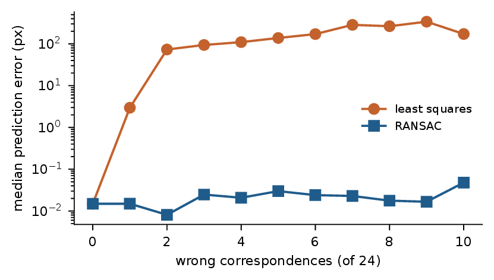

Affine and homography models were tested too, even though the physics says
similarity. The point was not to use them but to check: if the data genuinely
wanted a richer model—lens distortion, a non-rigid field—the extra degrees
of freedom would have reduced the residual appreciably. They did not, which
confirms the similarity model rather than merely assuming it.

## 6 · Transform

### Refitting and geometric checks

With a 2 px inlier threshold the residual is **0.29 px**. The transform is then
refit using *all* inliers from the best hypothesis rather than the two points
that generated it, which improves prediction accuracy **0.16 px → 0.034 px**.

The Earth turns at a constant rate, which gives a free consistency check: the
fitted transforms should be smooth—nearly linear—in time. A frame whose
drift departs from that trend has been mis-registered, whatever its residual
says.


### Choosing the reference frame

The reference frame is the only frame that is never resampled—and resampling
degrades a frame even under the identity transform, because interpolation is not
lossless. Therefore, the reference frame should:

- be the **sharpest** frame available;
- sit near the **middle** of the sequence, which maximises the area
  shared with every other frame, since only the region covered by all frames has
  complete data.

For 60 frames at 0.5 s with frame 52 as the reference, **77%** of the area is
shared across all frames.

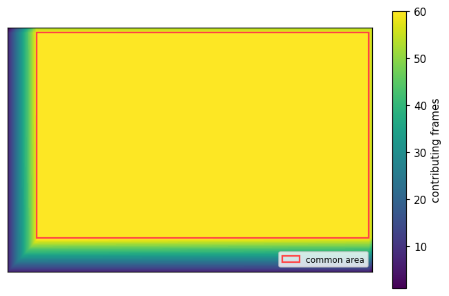

## 7 · Reconstruction

### Resampling

For a fit $p_\text{target} = sR\,p_\text{source} + t$, the map is inverted:

$$p_\text{source} = \frac{R^\top (p_\text{target} - t)}{s}.$$

The map runs *backwards*, from output pixel to source coordinate, because the
output grid is what must be filled. Pushing samples forward instead loses the
sub-pixel accuracy the centroids worked for—the whole point of a 0.03 px
transform is lost if the result is rounded to the nearest output pixel—and
under a scale change the forward map genuinely leaves gaps (3.8% of pixels at a
2% scale change, against 0.01% from rotation alone at these angles).

Interpolation is by B-spline, with the order chosen by measurement:

| Order | Noise σ | Lag-1 corr. | Peak error | Flux error |
| --- | --- | --- | --- | --- |
| 1 (bilinear) | 5.95 | 0.243 | −2.45% | 0.000% |
| **3 (cubic)** | **8.45** | 0.077 | −0.79% | 0.000% |
| 5 | 9.01 | **0.062** | **−0.78%** | 0.000% |

Bilinear's apparently *better* noise figure is the artefact: averaging two
neighbouring samples to make each output pixel makes adjacent output pixels
share input, so the per-pixel σ drops while the actual information content does
not. The lag-1 correlation column is what exposes it—0.243 against 0.077.
Order 5 buys almost nothing over order 3 and costs time.

Flux is preserved exactly by all three; peaks are not, which is why the FWHM
measured after warping is not comparable to the FWHM before.

### NaN handling

Not-a-number values enter the data from the RTS pixels: every sample below
**−50 ADU** is cut before processing, and a pixel enters the permanent bad-pixel
map if it is cold in at least three frames.

A spline would smear each NaN across its entire support, so the sequence is
**nearest-neighbour fill → warp → re-mask**: fill the holes so the interpolator
sees finite values everywhere, warp, then mark any output pixel that drew
appreciably on a filled sample back to NaN.

After reconstruction, everything outside the common area is marked NaN as well.
Marking it zero would imply a true dark measurement and produce vignetting in
the combined result.

### Combining frames

At each pixel independently, across frames:

1. take the median and the MAD-derived $\hat\sigma$ over that pixel's stack of
   values;
2. reject samples beyond $\kappa\hat\sigma$;
3. recompute both from the survivors, and repeat until the rejection mask stops
   changing.

This is per-pixel and across-frames, not spatial: each pixel's own time series
is cleaned, so a satellite trail, an aircraft, or a cosmic ray hit disappears
without touching the pixel's neighbours. Because the frames are registered, the
star is in the same place in every frame and survives; the transient is not and
does not.

Poisson noise varies across the image, so the weights are computed per frame
rather than globally. The final result is a per-frame **weighted average of
per-pixel medians**—the median gives robustness against transients, the
weighting penalises genuinely worse frames (thin cloud, focus drift) without
discarding them.

The transform is computed once and then applied to each of the four colour
channels separately, after which they are interleaved back into a Bayer mosaic.
That makes the output openable in ordinary photo software as a raw file, and
FITS is written alongside it as the astronomical standard with 32-bit precision.

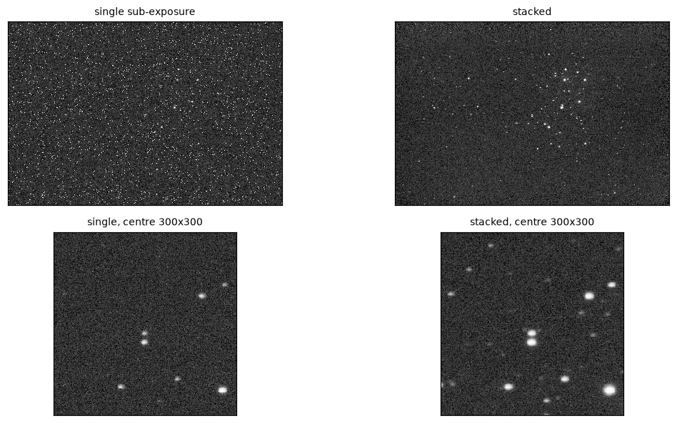

## 8 · Analysis

### Quantifying the result

There is no reference image, so the noise has to be measured from the data
itself. Split the frames into even ($A$) and odd ($B$) sets and stack each
independently:

$$\text{noise} = \frac{A - B}{2}, \qquad \text{signal} = \frac{A + B}{2}.$$

Both half-stacks see the same sky, so the astronomical signal is *identical* in
each and cancels exactly in the difference—no modelling, no masking, no
assumption about what is a star and what is not. The sum recovers the signal at
the same depth.

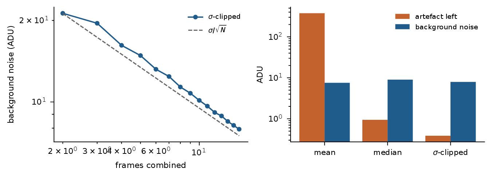

One caveat, since it is easy to overstate this estimator's virtues: resampling
correlates neighbouring pixels, and the half-split is affected by that just as
much as a plain per-pixel σ of the stack is—measurement puts the two within
0.6% of each other. What the half-split uniquely provides is *exact signal
removal*, which is what makes it usable with no ground truth at all.


## Demosaicing as an inverse problem

Everything above halves the resolution, either by taking a superpixel or by
averaging the two green sub-lattices. An alternative is to treat demosaicing as
an inverse problem and recover the full-resolution three-channel image:

$$\min_u \tfrac12 \|Mu - y\|^2 + \lambda R(u)$$

with $u$ the 3-channel image, $y$ the raw mosaic, $M$ the CFA sampling operator
and $R$ a regulariser. $M$ discards about two-thirds of the unknowns, so the
data term alone has a hugely underdetermined solution set—the regulariser is
what selects one.

The choice here is **isotropic total variation** (TV, from the Rudin–Osher–Fatemi
model),

$$R(u) = \|\nabla u\|_{2,1},$$

which prefers images with sparse gradients: flat regions separated by sharp
edges. The $\|\cdot\|_{2,1}$ mixed norm takes the $\ell_2$ norm *across* the
gradient components at each pixel—both spatial directions and all three
channels—and then the $\ell_1$ norm *over* pixels. The inner $\ell_2$ keeps it
isotropic and ties the channels together at each pixel; the outer $\ell_1$ is
what makes it sparsity-promoting.

### ADMM

The data term is quadratic and easy; the regulariser is non-smooth and awkward.
The alternating direction method of multipliers splits them, making each
subproblem one that has a closed form:

$$\min_u \tfrac12\|Mu - y\|^2 + \lambda R(v) \quad \text{s.t.} \quad u = v$$

$$\begin{aligned}
u^{(k+1)} &= (M^\top M + \rho I)^{-1}\big(M^\top y + \rho(v^{(k)} - w^{(k)})\big) \\
v^{(k+1)} &= \text{prox}_{\lambda R/\rho}\big(u^{(k+1)} + w^{(k)}\big) \\
w^{(k+1)} &= w^{(k)} + u^{(k+1)} - v^{(k+1)}
\end{aligned}$$

The $u$-step is a linear solve that is diagonal in this case, since $M^\top M$ is
a diagonal mask. The $v$-step is the proximal operator of the regulariser —
*not* $R$ itself, but the solution of
$\text{prox}_{\tau R}(z) = \arg\min_x \big(\tfrac12\|x - z\|^2 + \tau R(x)\big)$,
which for TV is the ROF denoising problem.

This is the useful structural property: the $v$-step depends on neither the data
$y$ nor the pattern $M$. It is a denoiser, and any denoiser can be dropped in —
BM3D, a trained network, a plug-and-play prior—without touching the rest of
the algorithm.

### How it compares

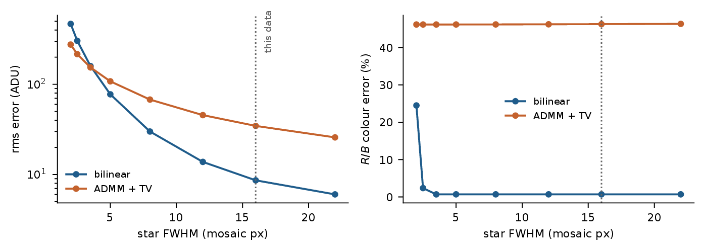

It loses, and the reason is instructive. TV penalises $\|\nabla u\|_{2,1}$
*across* channels, which imposes a shared gradient structure on the three
channels. For natural images that is correct—a real edge appears in all three
channels at once. For a **star field** it is not: a star's colour means its
channels have genuinely different profiles, and a prior that insists they agree
degrades exactly the measurement the pipeline is built around.

The baseline is crude: nearest-neighbour
fill with a Gaussian blur, not the AHD, RCD or LMMSE demosaic that Lightroom
would actually apply, which makes the negative result stronger, since ADMM+TV
is worse than a crude demosaic algorithm. And this is not the same operation as the cubic resampling
chosen earlier: resampling relocates samples that exist, demosaicing invents
samples that were never measured.

## Future work

**Longer exposures beat more short ones, where they are possible.** For a single
shot of duration $T$ with signal rate $S$, background $B$, dark current $D$
(negligible at $\mathcal{O}(\text{s})$) and read noise $\sigma_r$:

$$\text{SNR}_\text{stack} = \frac{ST}{\sqrt{(S + B + D)T + N\sigma_r^2}}$$

With $N$ frames the read noise enters $N$ times, so stacking $N$ short exposures
carries $N\sigma_r^2$ where one long exposure carries $\sigma_r^2$. The sky here
is not background-limited ($BT \approx 1.8\sigma_r^2$ against a target of 10),
which means read noise is still a real term and longer exposures would help
directly. That needs a **tracking mount**—otherwise the objects streak, which
is where this whole pipeline came from.

**The analysis is limited by the lens, not the software.**

- Chromatic aberration rules out any astrospectroscopy.
- Focus inconsistency makes astrophotometry difficult: the measured FWHM of
  8.4 × 7.8 px is about fifteen times the atmospheric seeing, so the dominant
  term is defocus. Trailing at 3.8 px per 2 s exposure sets the residual floor
  below that.

.png)

## References

- S. Umeyama, *Least-squares estimation of transformation parameters between two
  point patterns*, IEEE Trans. Pattern Anal. Mach. Intell. **13**(4), 376–380
  (1991). The closed-form similarity fit, including the determinant correction
  that excludes reflections.
- P. H. Schönemann, *A generalized solution of the orthogonal Procrustes
  problem*, Psychometrika **31**, 1–10 (1966).
- M. A. Fischler and R. C. Bolles, *Random sample consensus*, Commun. ACM
  **24**(6), 381–395 (1981).
- L. I. Rudin, S. Osher and E. Fatemi, *Nonlinear total variation based noise
  removal algorithms*, Physica D **60**, 259–268 (1992).
- S. Boyd et al., *Distributed optimization and statistical learning via the
  alternating direction method of multipliers*, Found. Trends Mach. Learn.
  **3**(1), 1–122 (2011).
- E. Bertin and S. Arnouts, *SExtractor: software for source extraction*,
  A&AS **117**, 393–404 (1996). The thresholding and moment-based measurement
  conventions.
